# NAVIQUAL-XR: Finding the Sweet Spot of a Live Music Environment in Augmented Reality
This repository contains the code to reproduce the results from the paper NAVIQUAL-XR: Finding the Sweet Spot of a Live Music Environment in Augmented Reality. This work has been submitted and is currently under review in ACM Transactions on Multimedia Computing, Communications, and Applications (ACM TOMM).

## What is NAVIQUAL-XR?
NAVIQUAL-XR is a framework to identify the spot with the best quality of experience in a given live music environment. The system overview of NAVIQUAL-XR is shown in the following figure. Participants wearing augmented reality (AR) glasses were asked to find the sweet spot in different live music scene configurations. These sweet spot selections served as the ground truth for evaluating the objective metrics that predicted these sweet spots.

  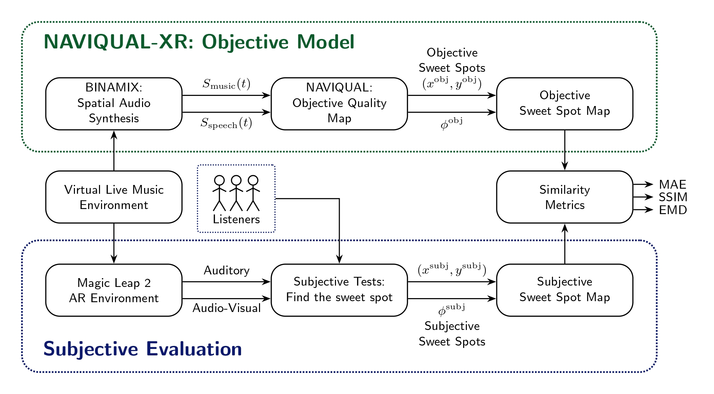
   
  <em>Figure 1: System overview of evaluating NAVIQUAL-XR</em>

## Setup

## Navigation Behavior
* Run `python 1_analyze_navigation.py` to analyze the participant trajectories under different scene conditions.
* Some figures are shown here to compare trajectories between between audio-only and audio-visual conditions.
* The full set of figures for six auditory and six audio-visual scenes are located in [here](./output/1_navigation_behaviour/).

  
  
  
   
  
  
  
   
  <em>Figure 2: Participant navigation trajectories from the initial position to selected subjective sweet spots. The top and bottom rows depict audio-only and audio-visual environments, respectively. Audio-visual conditions yielded direct navigation paths, whereas auditory conditions prompted broader spatial exploration.</em>

## Participant Sweet Spot Selections
* Run `python 2_analyze_sweetspots.py` to generate the participant sweet spot selections for all twelve scenes.
* Some figures are shown here to compare sweet spot selections under different scene conditions.
* The full set of figures are located in [here](./output/2_participant_sweetspots/).

  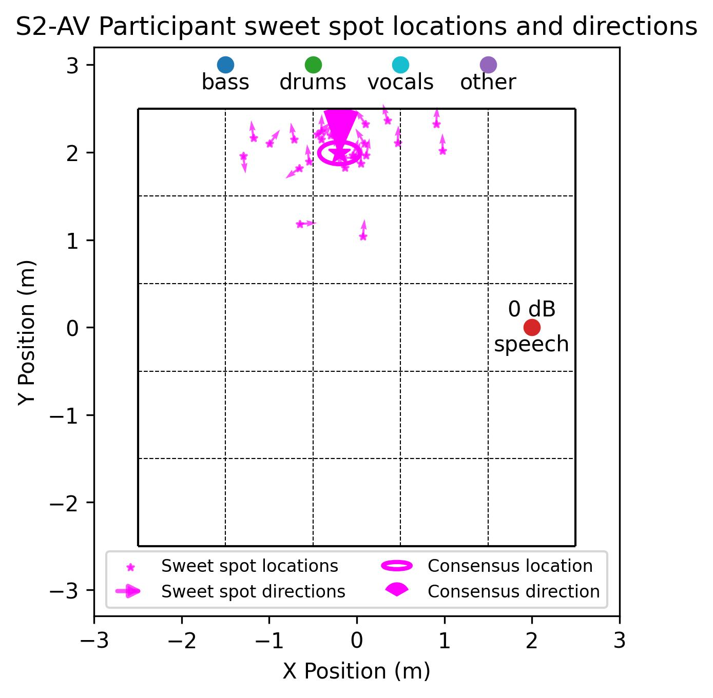
  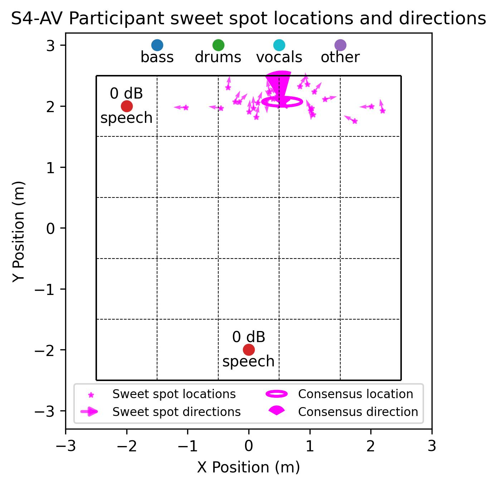
  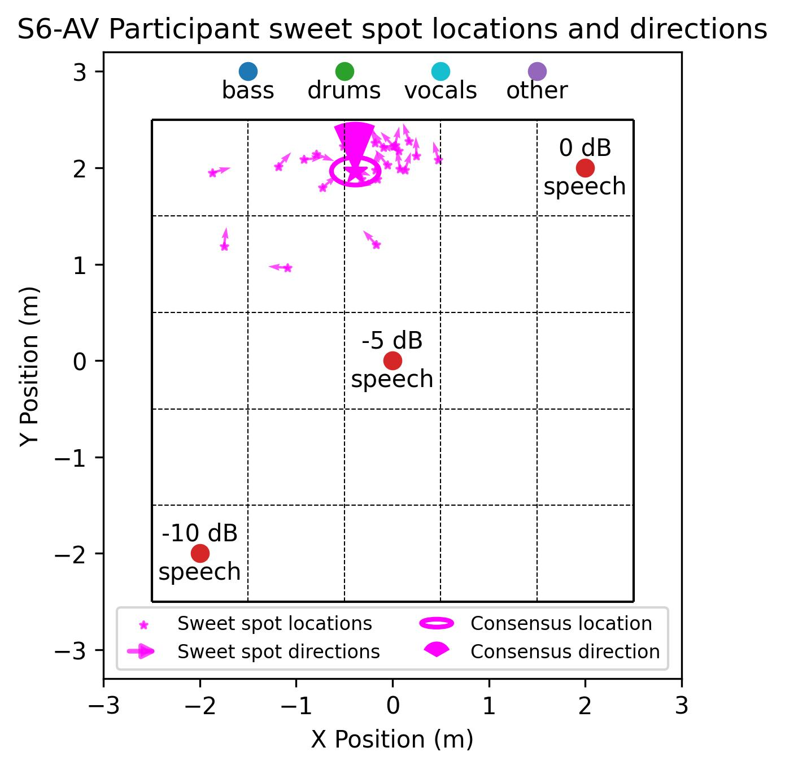
   
  <em>Figure 3: Subjective sweet spot locations and directions across three audio-visual scenes. Consensus sweet spots shift away from speech distractors while maintaining preferred acoustic balance of the music sources.</em>

## Sweet Spots under Auditory vs Audio-Visual Modalities
* Run `python 3_analyze_modalities.py` to generate intra-participant sweet spot selections under two cue modalities.
* The full set of figures for all six scene conditions are located in [here](./output/3_cue_modalities/).

  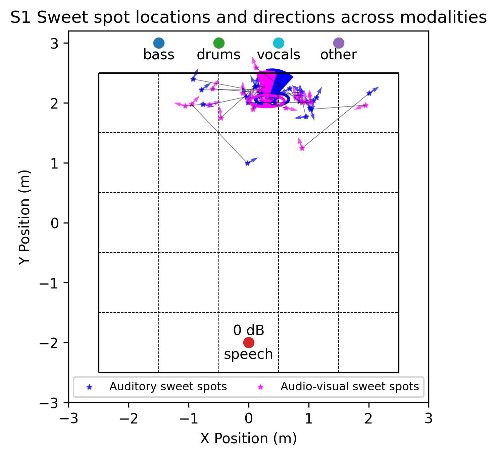
  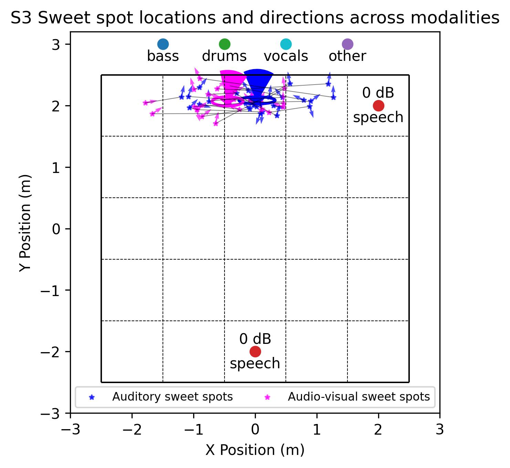
  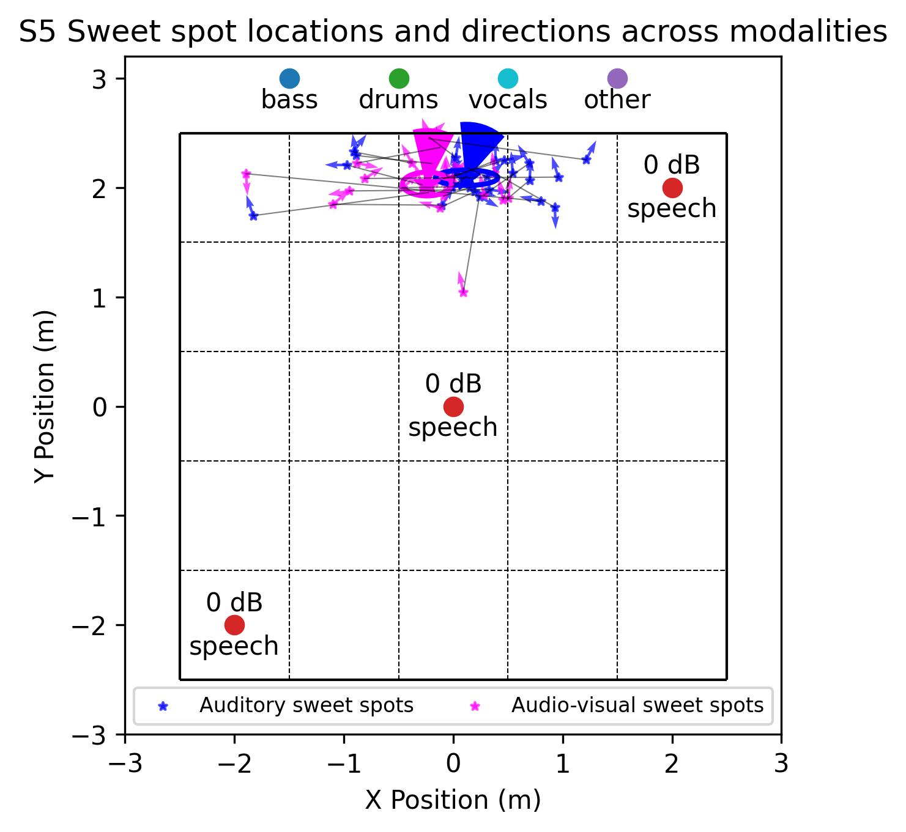
   
  <em>Figure 4: Participant sweet spot selections in auditory vs audio-visual modalities with increasing number of distractor sources. Sweet spot shifts become more pronounced as distractor sources increase, demonstrating that visual cues intensified participant avoidance from distractor sources.</em>

## Subjective Sweet Spot Maps
* Run `python 4_subjective_maps.py` to generate the subjective sweet spot maps with respect to listener location and direction. 
* These animations show how the subjective sweet spots shift with respect to the listener direction.
* The full set of animations for six auditory scenes and six audio-visual scenes are located in [here](./output/4_subjective_maps/).

  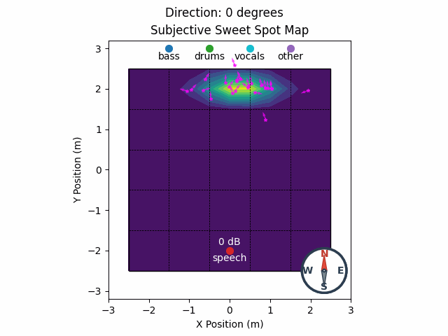
   
  <em>Figure 5: Subjective sweet spot maps with respect to listener location and direction. Participant sweet spot locations shift with respect to listener direction. Generally, participant sweet spots shift toward the right as participant heading rotates counterclockwise, such that participants maintain their direction toward the music sources.</em>

## Objective Sweet Spot Maps
* Run `python 5_objective_maps.py` to generate the objective sweet spot maps based on signal-to-noise ratio (SNR) and localization quality (LQ).
* These animations show the objective sweet spot predictions based on SNR and LQ.
* The full set for all scenes are located in [here](./output/5_objective_maps).

  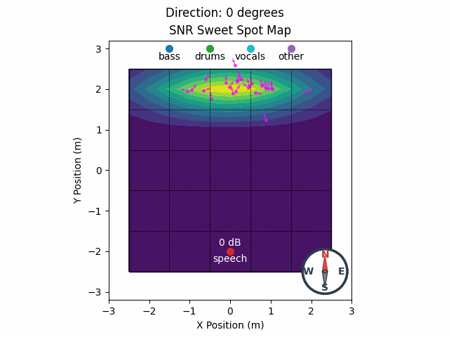
  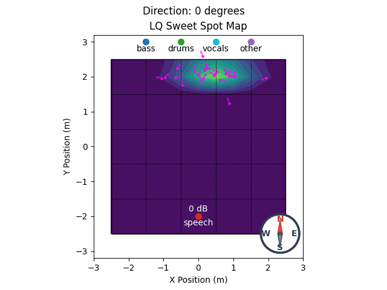
   
  <em>Figure 6: Objective sweet spot maps based on SNR and LQ. As the listener direction rotates counter-clockwise, the LQ-predicted sweet spot shifts to the right to maintain participant heading toward the music sources. In contrast, the SNR-predicted sweet spot shifts to the left, orienting away from the speech distractor rather than towards the music sources. </em>

## Polar Plots
* Run `python 5_polar_plots.py` to generate the polar plots at a fixed listener location based on the subjective and objective maps.
* These plots identify the listener direction with optimal QoE.
* The full set for all scenes are located in [here](./output/5_polar_plots).

  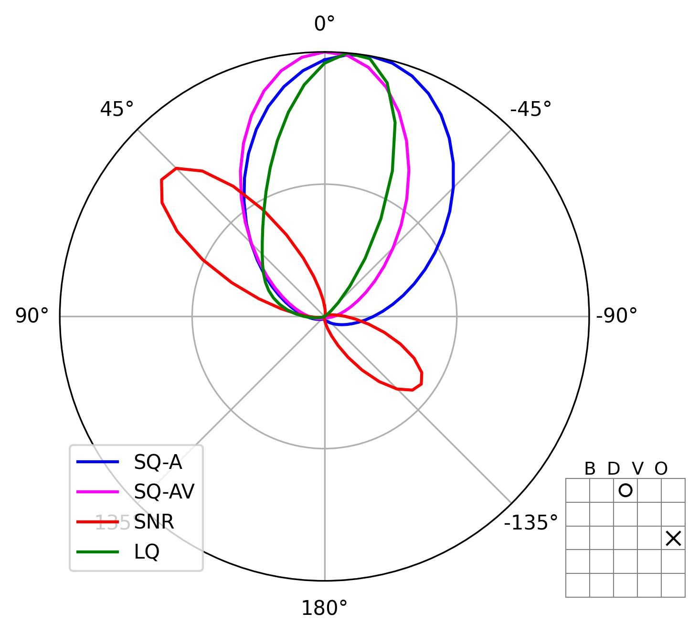
  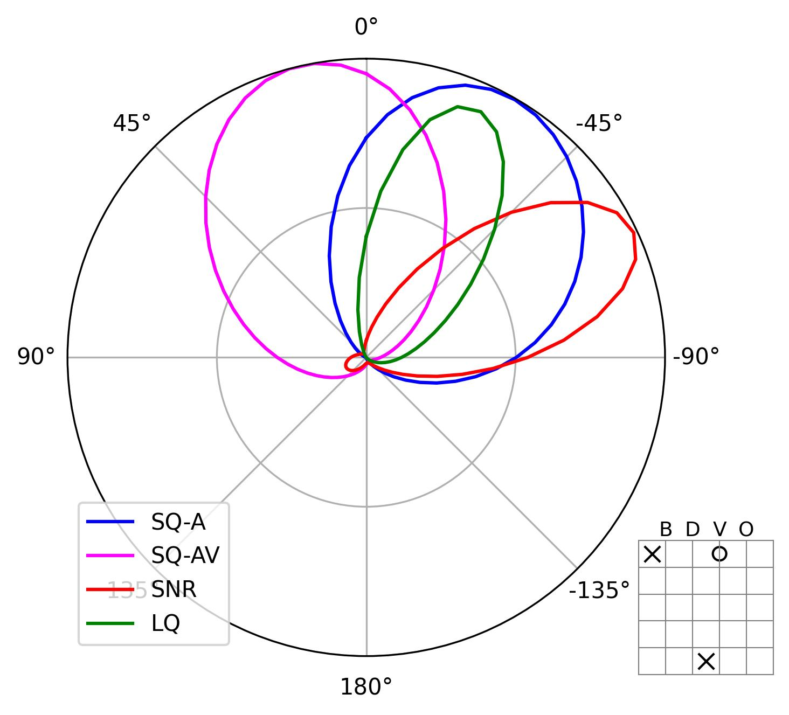
  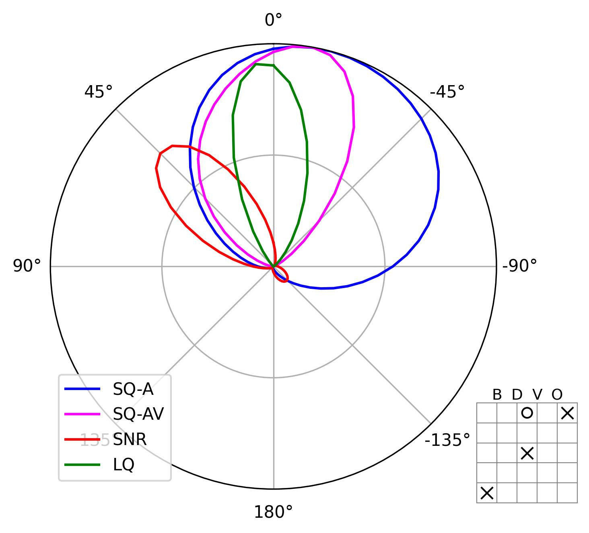
   
  <em>Figure 7: Polar plots of the normalized subjective and objective sweet spot scores at a fixed listener location. We can observe that the subjective sweet spot directions (blue and magenta) were better predicted by LQ (green) than SNR (red).</em>

 

## Subjective vs Objective Sweet Spot Maps
* Run `python 5_subjective_objective.py` to generate the subjective and objective sweet spot comparisons across scenes.
* These animations show the side-by-side comparisons of the subjective and objective sweet spot maps.
* The full set are located in [here](./output/5_subjective_objective)

  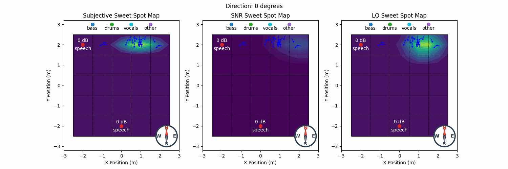
   
  <em>Figure 8: Subjective and objective sweet spot maps with respect to listener location and direction. We can observe more similarity of the LQ-predicted sweet spots (third figure) with the subjective results (first figure) compared to SNR predictions (second figure) </em>

## Similarity Metrics
* Run `python 6_similarity_metrics.py` to compute for the mean absolute error (MAE), structural similarity index measure (SSIM), and Earth Mover's Distance (EMD) similarity metrics.
* These metrics quantitatively evaluate the objective metrics in terms of accurately predicting the sweet spots obtained from the subjective tests.
* Based on the table, the similarity of the LQ map with the subjective map outperformed that of the SNR map in all scenes and modalities.
* Generally, the LQ predictions aligned more closely with the subjective sweet spots in audio-visual environments compared to auditory-only. This signifies that incorporating visual cues helped the participants accurately locate the binaural signal with optimal quality, rather than relying on auditory-only stimuli. 

<b>Table 1: Similarity metric scores between the subjective and objective sweet spot maps</b>

<table align="center">
  <thead>
    <tr>
      <th rowspan="3" align="center">Scene</th>
      <th colspan="4" align="center">MAE</th>
      <th colspan="4" align="center">SSIM</th>
      <th colspan="4" align="center">EMD</th>
    </tr>
    <tr>
      <th colspan="2" align="center">Auditory</th>
      <th colspan="2" align="center">Audio-visual</th>
      <th colspan="2" align="center">Auditory</th>
      <th colspan="2" align="center">Audio-visual</th>
      <th colspan="2" align="center">Auditory</th>
      <th colspan="2" align="center">Audio-visual</th>
    </tr>
    <tr>
      <th align="center">SNR</th>
      <th align="center">LQ</th>
      <th align="center">SNR</th>
      <th align="center">LQ</th>
      <th align="center">SNR</th>
      <th align="center">LQ</th>
      <th align="center">SNR</th>
      <th align="center">LQ</th>
      <th align="center">SNR</th>
      <th align="center">LQ</th>
      <th align="center">SNR</th>
      <th align="center">LQ</th>
    </tr>
  </thead>
  <tbody>
    <tr>
      <td align="center"><b>S1</b></td>
      <td align="center">0.0275</td>
      <td align="center"><b>0.0127</b></td>
      <td align="center">0.0297</td>
      <td align="center"><u><b>0.0101</b></u></td>
      <td align="center">0.7609</td>
      <td align="center"><b>0.8467</b></td>
      <td align="center">0.7251</td>
      <td align="center"><u><b>0.9179</b></u></td>
      <td align="center">0.1941</td>
      <td align="center"><b>0.1645</b></td>
      <td align="center">0.1904</td>
      <td align="center"><u><b>0.1367</b></u></td>
    </tr>
    <tr>
      <td align="center"><b>S2</b></td>
      <td align="center">0.0236</td>
      <td align="center"><b>0.0138</b></td>
      <td align="center">0.0214</td>
      <td align="center"><u><b>0.0119</b></u></td>
      <td align="center">0.8082</td>
      <td align="center"><b>0.8735</b></td>
      <td align="center">0.8099</td>
      <td align="center"><u><b>0.8838</b></u></td>
      <td align="center">0.2182</td>
      <td align="center"><u><b>0.1499</b></u></td>
      <td align="center">0.2104</td>
      <td align="center"><b>0.1537</b></td>
    </tr>
    <tr>
      <td align="center"><b>S3</b></td>
      <td align="center">0.0231</td>
      <td align="center"><b>0.0179</b></td>
      <td align="center">0.0185</td>
      <td align="center"><u><b>0.0135</b></u></td>
      <td align="center">0.7797</td>
      <td align="center"><b>0.8094</b></td>
      <td align="center">0.8372</td>
      <td align="center"><u><b>0.8772</b></u></td>
      <td align="center">0.2327</td>
      <td align="center"><b>0.1862</b></td>
      <td align="center">0.2027</td>
      <td align="center"><u><b>0.1545</b></u></td>
    </tr>
    <tr>
      <td align="center"><b>S4</b></td>
      <td align="center">0.0163</td>
      <td align="center"><u><b>0.0103</b></u></td>
      <td align="center">0.0216</td>
      <td align="center"><b>0.0137</b></td>
      <td align="center">0.8425</td>
      <td align="center"><u><b>0.9144</b></u></td>
      <td align="center">0.8187</td>
      <td align="center"><b>0.8628</b></td>
      <td align="center">0.1576</td>
      <td align="center"><u><b>0.1345</b></u></td>
      <td align="center">0.2014</td>
      <td align="center"><b>0.1709</b></td>
    </tr>
    <tr>
      <td align="center"><b>S5</b></td>
      <td align="center">0.0206</td>
      <td align="center"><b>0.0145</b></td>
      <td align="center">0.0169</td>
      <td align="center"><u><b>0.0100</b></u></td>
      <td align="center">0.8390</td>
      <td align="center"><b>0.8751</b></td>
      <td align="center">0.8436</td>
      <td align="center"><u><b>0.9222</b></u></td>
      <td align="center">0.2307</td>
      <td align="center"><b>0.1781</b></td>
      <td align="center">0.2053</td>
      <td align="center"><u><b>0.1523</b></u></td>
    </tr>
    <tr>
      <td align="center"><b>S6</b></td>
      <td align="center">0.0225</td>
      <td align="center"><b>0.0158</b></td>
      <td align="center">0.0220</td>
      <td align="center"><u><b>0.0117</b></u></td>
      <td align="center">0.8387</td>
      <td align="center"><b>0.8716</b></td>
      <td align="center">0.8486</td>
      <td align="center"><u><b>0.8971</b></u></td>
      <td align="center">0.2401</td>
      <td align="center"><b>0.1985</b></td>
      <td align="center">0.2216</td>
      <td align="center"><u><b>0.1566</b></u></td>
    </tr>
    <tr>
      <td align="center"><b>Mean</b></td>
      <td align="center">0.0223</td>
      <td align="center"><b>0.0142</b></td>
      <td align="center">0.0217</td>
      <td align="center"><u><b>0.0118</b></u></td>
      <td align="center">0.8115</td>
      <td align="center"><b>0.8651</b></td>
      <td align="center">0.8139</td>
      <td align="center"><u><b>0.8935</b></u></td>
      <td align="center">0.2122</td>
      <td align="center"><b>0.1686</b></td>
      <td align="center">0.2053</td>
      <td align="center"><u><b>0.1541</b></u></td>
    </tr>
  </tbody>
</table>
 
