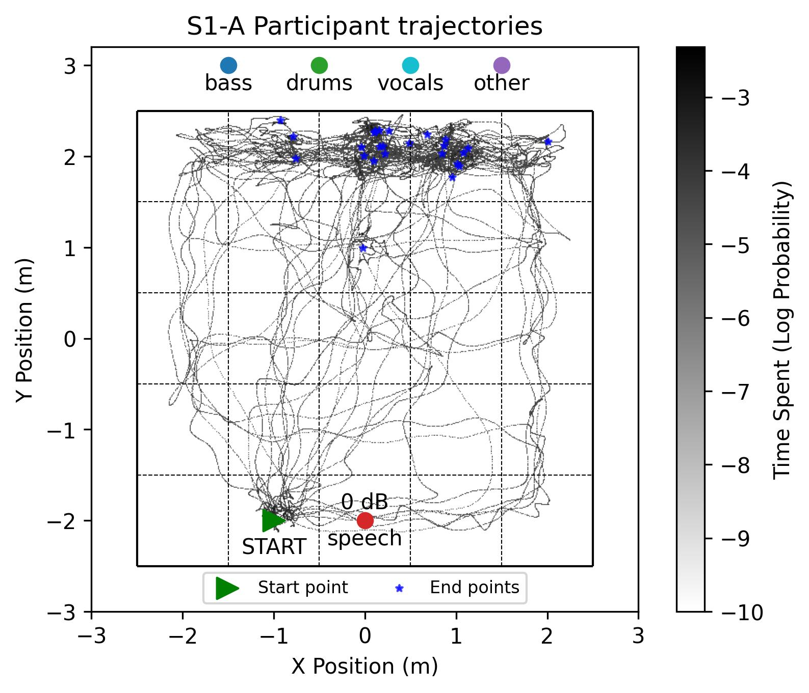
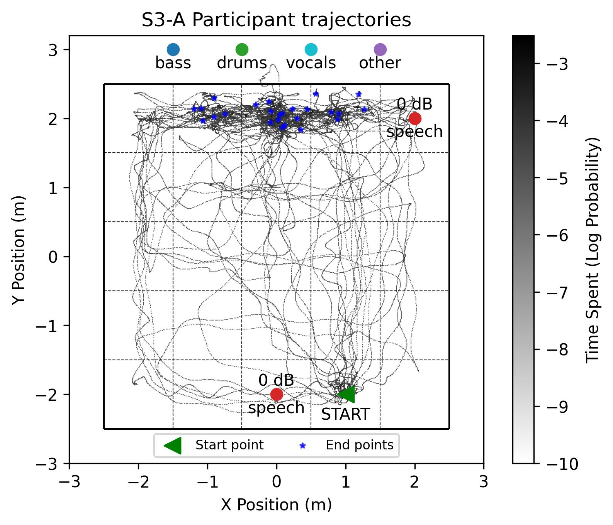
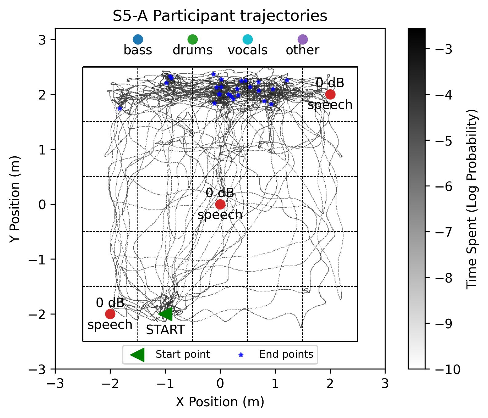
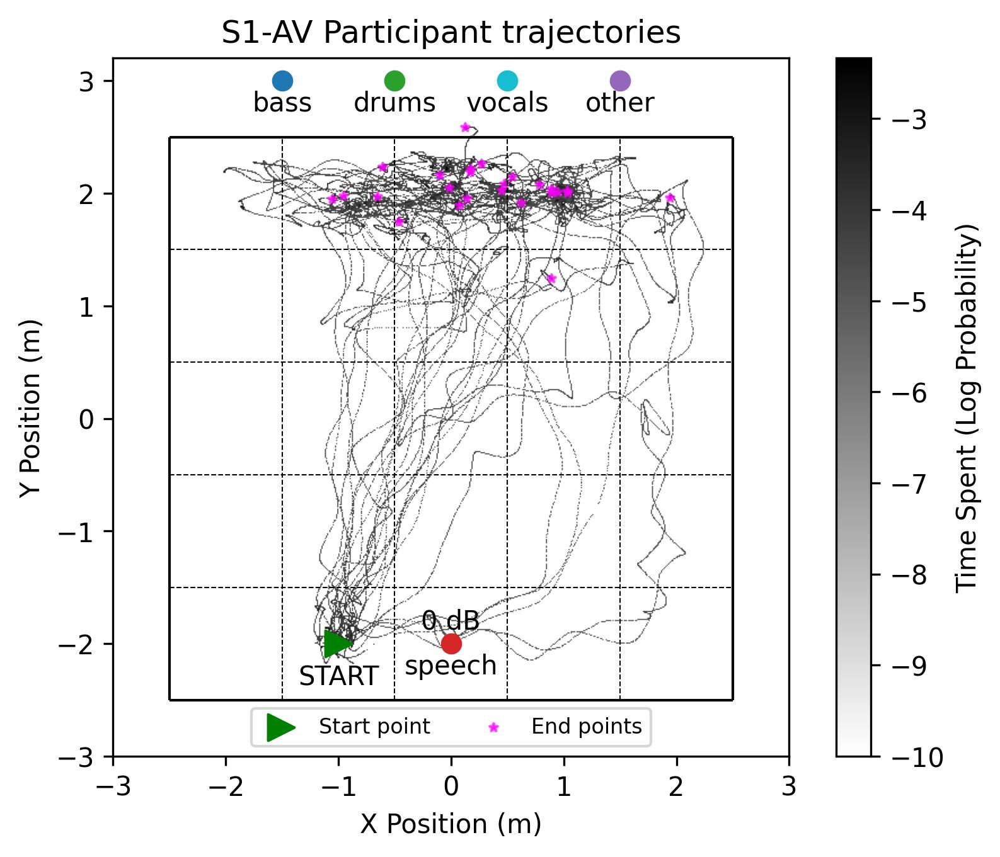
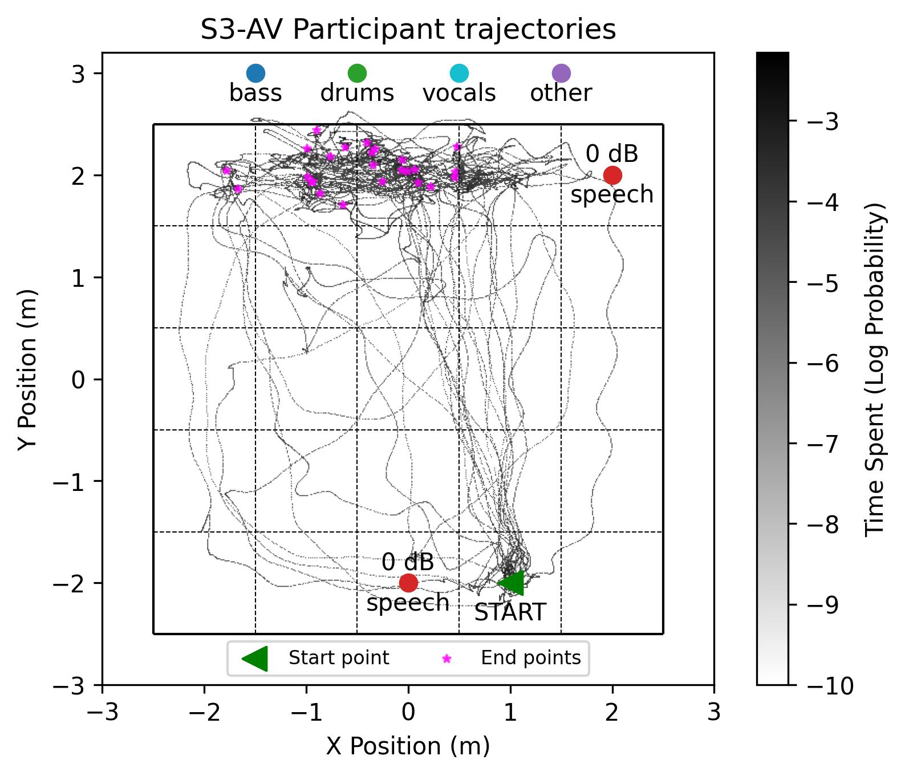
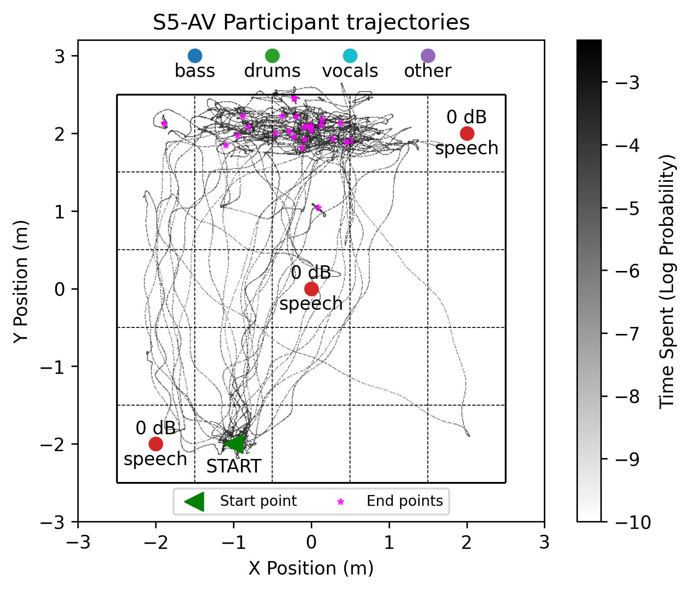

# NAVIQUAL-XR: Finding the Sweet Spot of a Live Music Environment in Augmented Reality
This repository contains the code to reproduce the results from the paper NAVIQUAL-XR: Finding the Sweet Spot of a Live Music Environment in Augmented Reality. This work is currently under review in ACM Transactions on Multimedia Computing, Communications, and Applications (ACM TOMM).

## What is NAVIQUAL-XR?
NAVIQUAL-XR is a framework to identify the spot with the best quality of experience in a given live music environment. The system overview of NAVIQUAL-XR is shown in the following figure. Participants wearing augmented reality (AR) glasses were asked to find the sweet spot in different live music scene configurations. These sweet spot selections served as the ground truth for evaluating the objective metrics that predicted these sweet spots.

## Setup

## Navigation Behavior
* Run `python 1_analyze_navigation.py` to analyze the participant trajectories under different scene conditions.
* Some figures are shown here to compare trajectories between between audio-only and audio-visual conditions.
* The full set of figures for six auditory and six audio-visual scenes are located in [here](./output/1_navigation_behaviour/)

  
  
  
   
  
  
  
   
  <em>Figure 1: Participant navigation trajectories from the initial position to selected subjective sweet spots. The top and bottom rows depict audio-only and audio-visual environments, respectively. Audio-visual conditions yielded direct navigation paths, whereas auditory conditions prompted broader spatial exploration.</em>

## Participant Sweet Spot Selections

## Sweet Spots under Auditory vs Audio-Visual Modalities

## Subjective Sweet Spot Maps

## Objective Sweet Spot Maps

## Subjective vs Objective Sweet Spot Maps

## Similarity Metrics
